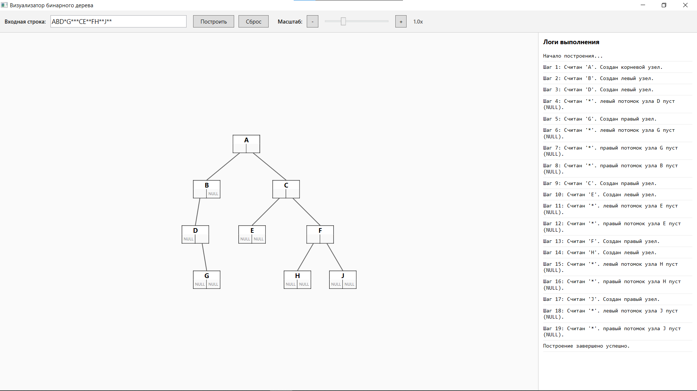

# 🌳 Визуализатор бинарного дерева (WPF)
Desktop-приложение на базе C# / WPF, предназначенное для пошаговой визуализации и интерактивного редактирования бинарного дерева. Программа парсит строковое представление дерева (прямой обход), отрисовывает его с анимацией и позволяет изменять структуру «на лету».


# ✨ Основные возможности
- **Пошаговое построение:** Чтение строки происходит символ за символом. Каждый узел появляется на экране с задержкой, а в панель логов выводится подробное пояснение каждого шага.
- **Интерактивное редактирование:**
  - 🟢 **Добавление:** Кликните на ячейку NULL у любого узла, введите букву, и новый лист будет создан.
  - 🔴 **Удаление:** Кликните по значению узла-листа (курсор сменится на руку), чтобы удалить его.
  - 🔄 **Синхронизация:** Любое изменение автоматически пересчитывает структуру дерева и обновляет исходную строку ввода (буквы и звездочки).
- **Умная компоновка (Layout):** Алгоритм динамически центрирует дерево на экране. Ветки красиво скашиваются в стороны, а размеры холста подстраиваются под количество узлов.
- **Масштабирование:** Удобный слайдер для изменения масштаба дерева (от 20% до 300%).
- **Валидация данных:** Программа проверяет входную строку на корректность, обрабатывает нехватку символов, лишние символы и запрещенные знаки.
- **Архитектура MVVM:** Чистое разделение логики, данных и представления (UI).

# 📝 Формат входных данных
**Дерево описывается строкой, которая представляет собой прямой обход (Pre-order):**
`Корень -> Левый -> Правый`. Пустой связи (отсутствие потомка) соответствует символ `*`.

**Пример:** `ABD*G***CE**FH**J**`

Расшифровка:
1. `A` — корень.
2. `B` — левый потомок `A`.
3. `D` — левый потомок `B`.
4. `*` — левый потомок `D` пуст.
5. `G` — правый потомок `D`.
6. `*` — левый потомок `G` пуст.
7. `*` — правый потомок `G` пуст.
8. `*` — правый потомок `B` пуст.
... и так далее.
   
# 🛠️ Технологии и требования
- **Платформа:** .NET (рекомендуется .NET 8 или новее)
- **Язык:** C#
- **UI:** WPF (Windows Presentation Foundation), XAML
- **Архитектурный паттерн:** MVVM (Model-View-ViewModel)

# 📂 Структура проекта
```text
TreeVisualizer/
├── Models/                  # Модели данных (TreeNode, VisualNode, VisualConnection)
├── ViewModels/              # Логика приложения (MainViewModel)
├── Helpers/                 # Вспомогательные классы (RelayCommand)
├── Views/                   # XAML-представления (MainWindow, InputDialog)
├── App.xaml                 # Точка входа
└── README.md
```
